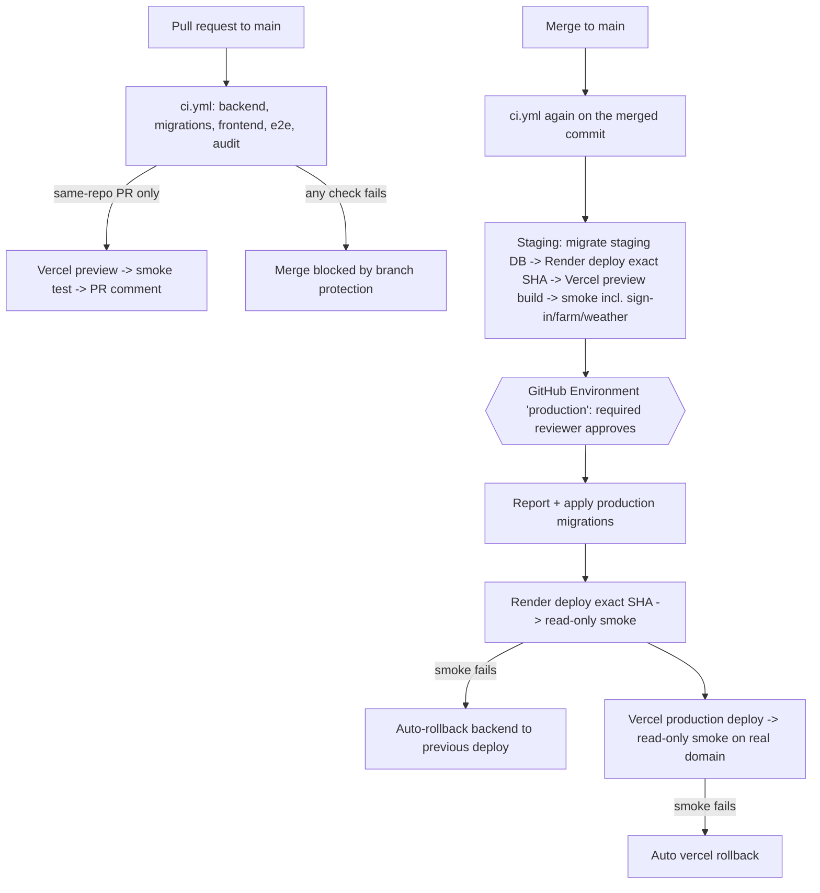

# AgriSense: CI/CD (implemented, Docker-free)

**Status (2026-11-24):** workflows, scripts and provider configuration are in the repo, and every CI job has been run locally (see §8). The GitHub repo, Render services and Vercel project **do not exist yet**, so nothing has run on GitHub. Complete the one-time setup in §4 first.

No Docker anywhere. Python and Node come from `actions/setup-*`. PostgreSQL and Chromium are installed as native Ubuntu packages on the runner. Render uses its native Python runtime.

## 1. Pipeline

| Workflow | Trigger | Purpose |
|---|---|---|
| `.github/workflows/ci.yml` | called by the two below, or run manually | The quality gate. Uses no secrets. |
| `.github/workflows/pull-request.yml` | PRs to `main` | CI, then a Vercel preview and smoke test for same-repo PRs |
| `.github/workflows/deploy.yml` | push to `main`, manual | CI, then staging (automatic), then production (**approval required**) |
| `.github/workflows/rollback.yml` | manual | Rolls back backend and/or frontend; production requires approval |
| `.github/dependabot.yml` | weekly | Update PRs for actions, pip and npm; each one passes the same CI |

### CI jobs (`ci.yml`)

| Job | What it runs |
|---|---|
| **Backend** | `pip install -r requirements-dev.txt`, `ruff check`, `ruff format --check`, `pytest` (in-memory SQLite) |
| **Migrations** | Installs PostgreSQL **17** (Supabase's major version) and **PostGIS** from apt, then creates a disposable `agrisense_test` database shaped like Supabase: an `extensions` schema, and `anon`/`authenticated` roles with Supabase's default grants. It then runs `backend/scripts/validate_migrations.sh`: upgrade → `alembic check` (no drift) → downgrade base → upgrade → the full pytest suite on PostgreSQL, including the guard that every table has RLS and no Data API grants. No secrets, nothing shared, discarded with the runner. |
| **Frontend** | `npm ci`, `npm run lint` (ESLint + jsx-a11y), `npm run typecheck`, `npm test` (Vitest), `npm run build` |
| **Browser tests** | Playwright (desktop + phone touch), using a throwaway SQLite backend and `e2e/fake_nasa.py`. The report is uploaded on failure. |
| **Dependency audit** | `pip-audit` on backend requirements, and `npm audit --omit=dev --audit-level=high` |

Hardening:
- Every third-party action is pinned to a full commit SHA, with the version in a comment. Dependabot proposes updates.
- Default `permissions: contents: read`. Only the preview job may write PR comments.
- Fork PRs never reach jobs that use secrets: they're skipped by an explicit `if`, and GitHub also withholds secrets from forks.
- Values from PR events are passed via `env:` rather than interpolated into shell commands.
- `deploy.yml` and `rollback.yml` share the concurrency group `deploy-main` with `cancel-in-progress: false`, so a deploy, migration or rollback is never cut off halfway or overlapped by another.

## 2. Why each gate exists

- **Tests must pass before production.** `staging` `needs: ci`, and `production` `needs: staging`. CI runs again on the merged commit, not just the PR head.
- **Exact artifact.** Render deploys `commitId: github.sha` through its API. Render auto-deploy is `off` (`render.yaml`), and Vercel Git deployments are disabled (`frontend/vercel.json`), so nothing reaches staging or production except this workflow and the commit it tested.
- **Explicit approval.** The `production` job uses the GitHub Environment `production`, which must have required reviewers and a "main only" branch rule. Production database migrations and production deploys both sit inside that job, so **neither can run without a reviewer approving that specific run.** Staging migrations run automatically, because staging is a separate database.
- **Migrations run in CI, not in Render.** Render's `preDeployCommand` is paid-only, and it would run migrations outside the approval gate.

## 3. Secrets and variables

Secrets are **scoped to GitHub Environments**, so the same name holds a different value per environment and a PR job can never read production values. Repository-level secrets: **none**.

| Environment | Secrets | Variables |
|---|---|---|
| `preview` | `VERCEL_TOKEN`, `VERCEL_ORG_ID`, `VERCEL_PROJECT_ID`, `VERCEL_AUTOMATION_BYPASS_SECRET`¹ | `API_URL` (the **staging** API origin) |
| `staging` | `DATABASE_MIGRATION_URL`² (staging Supabase), `RENDER_API_KEY`, `VERCEL_TOKEN`, `VERCEL_ORG_ID`, `VERCEL_PROJECT_ID`, `SMOKE_EMAIL`, `SMOKE_PASSWORD`³, `VERCEL_AUTOMATION_BYPASS_SECRET`¹ | `RENDER_SERVICE_ID` (staging `srv-…`), `API_URL` |
| `production` | `DATABASE_MIGRATION_URL`² (production Supabase), `RENDER_API_KEY`, `VERCEL_TOKEN`, `VERCEL_ORG_ID`, `VERCEL_PROJECT_ID` | `RENDER_SERVICE_ID` (production `srv-…`), `API_URL`, `WEB_URL` (production domain) |

1. Only needed if Vercel Deployment Protection is on for previews. Create it under Project → Settings → Deployment Protection → Protection Bypass for Automation.
2. Use a migration-capable connection: the Supabase session pooler (port 5432) or the direct connection. **Not** the transaction pooler (6543). Add `?sslmode=require`.
3. A dedicated test account used only on staging. The smoke test registers it on first run. Production smoke tests are read-only and use no account.

**Runtime secrets do not live in GitHub.** The API's `DATABASE_URL`, `JWT_SECRET` (generated by Render) and CORS settings live in Render. The frontend's `VITE_API_BASE_URL` lives in Vercel's Preview and Production environments. `VITE_*` values are public by design: never put secrets there.

## 4. One-time setup (manual; needs your accounts)

1. **GitHub.** Push the repo, then:
   - Settings → **Environments**: create `preview`, `staging` and `production`. On `production`, add **Required reviewers** (yourself) and **Deployment branches: `main` only**.
   - Add the secrets and variables from §3.
   - Branch protection on `main`: require a PR, and require these status checks: `ci / Backend (Ruff, pytest)`, `ci / Migrations (PostgreSQL 17 + PostGIS)`, `ci / Frontend (ESLint, types, Vitest, build)`, `ci / Browser tests (Playwright)`, `ci / Dependency audit`.
   - Enable secret scanning with push protection (Settings → Code security).
2. **Supabase.** Two projects: **staging** (the current dev project can serve) and **production**. In each: enable PostGIS, then run migrations through the pipeline, never by hand against production. Check whether your plan includes backups. On the free plan, take a manual `pg_dump` before approving any production run that includes migrations.
3. **Render.** New → **Blueprint** → this repo. It creates `agrisense-api-staging` and `agrisense-api` from `render.yaml`. Enter the `sync: false` values when prompted:
   - `DATABASE_URL`: the session pooler URI.
   - `CORS_ORIGINS`.
   - `CORS_ORIGIN_REGEX` (staging only): e.g. `^https://agrisense-[a-z0-9-]+-<team>\.vercel\.app$`.

   Then copy each service ID (`srv-…`) and create an API key (Account → API Keys). After the first deploy, confirm **Python 3.12** in the build log. The Blueprint docs don't document version selection; the repo provides `backend/.python-version`.
4. **Vercel.** Create a project from this repo with **Root Directory left blank**: CI runs the CLI inside `frontend/`, which holds `vercel.json`. Set `VITE_API_BASE_URL` for **Preview** (staging API) and **Production** (production API). From `frontend/`, run `npx vercel link` once to get the org and project IDs from `.vercel/project.json`, then create a token. Git deployments are already disabled in `vercel.json`.
5. **Cost.** All services above have free tiers: GitHub Actions minutes for private repos are limited, and public repos are free. Render's free instances **sleep when idle**, so the first request takes about a minute. Fine for staging; for production, move to Render's smallest paid instance before inviting farmers (`plan:` in `render.yaml`).

## 5. Release procedure

1. Open a PR. CI must be green; check the preview URL in the PR comment.
2. Merge. `deploy.yml` runs CI on the merged commit, then deploys **staging** and smoke-tests it, including sign-in, farm create/read/delete and the weather summary.
3. Production waits in **Actions → Deploy → Review deployments**. Before approving, check:
   - the staging smoke result;
   - whether the PR changed `backend/alembic/versions/` (if so, confirm the backup from §4.2);
   - that the migrations are expand-only (§7).
4. Approve. The job:
   - writes current and target revisions to the run summary;
   - applies migrations;
   - deploys the backend and smoke-tests it read-only;
   - deploys the frontend and smoke-tests the real domain;
   - records deploy IDs in the run summary.

## 6. Failure handling

| Failure | What happens automatically | What you do |
|---|---|---|
| Any CI check | Merge blocked (PR) / nothing deployed (main) | Fix and push |
| Staging migration | Postgres transactional DDL rolls the migration back; pipeline stops; production untouched | Fix the migration and merge a new commit |
| Render build or start fails | Render keeps the previous deploy live; the script exits with the status | Read the Render build log |
| Staging smoke test | Production job never starts | Investigate staging; fix forward |
| Approval rejected or not given | Nothing runs against production | n/a |
| Production migration | Rolled back by transactional DDL; job stops **before** any production deploy | Fix forward; restore from backup only if data was damaged |
| Production backend smoke | **Auto-rollback** to the previous Render deploy (ID captured before deploying); frontend not deployed | Investigate. Schema is already migrated, which is safe under the expand-only rule |
| Production frontend smoke | **Auto `vercel rollback`** to the previous production deployment | Investigate; the backend stays on the new version (backward-compatible) |
| Weather provider outage during smoke | Logged as degraded, not a failure (NASA outages aren't our release's fault) | n/a |

## 7. Rollback strategy

- **Application code:** use the **Rollback** workflow (Actions → Rollback → Run workflow). Pick the environment and components. Optionally give a Render deploy ID or Vercel deployment; the defaults are the previous successful backend deploy and the previous production frontend. Production requires the same approval. A read-only smoke test runs afterwards. The dashboards work too: Render → Deploys → Rollback; Vercel → Deployments → Instant Rollback.
- **Database:** **no automatic downgrades in production.** Rollback is fix-forward with a new migration. This is safe only if migrations follow **expand → migrate → contract**:
  1. **Expand:** add nullable columns or new tables only. The previous app version keeps working, which makes app rollback safe.
  2. **Migrate:** deploy the code that uses them, and backfill.
  3. **Contract:** drop old columns or tables in a *later* release, once no deployed version reads them. Example: `weather_cache`, unused since migration 0003, should be dropped in a separate release.

  Destructive changes (drop or rename) are never combined with the code change that stops using them.
- **Data loss** (last resort): restore the Supabase backup or the manual `pg_dump` taken before approving.

## 8. Local verification (2026-11-24)

Everything below ran locally. The GitHub-hosted parts can't run until §4 is done.

| Check | Result |
|---|---|
| Backend job in a fresh virtualenv (Ruff lint, format, pytest) | clean; 52 passed, 1 skipped (PostgreSQL-only test) |
| Migrations job via `validate_migrations.sh` (same SQL setup, local PostgreSQL 16 without PostGIS) | upgrade → no drift → downgrade → upgrade; **53 passed** incl. RLS guard; refuses a non-`test` DB |
| Frontend job from a clean `npm ci` | ESLint, types clean; 44 Vitest passed; build OK |
| Browser tests with `CI=true` | 23 passed, 1 skipped (mouse wheel on phone) |
| Dependency audit | pip-audit: no known vulnerabilities; npm audit (runtime, high+): 0 |
| `scripts/smoke_test.py` against a local production build + throwaway API | all 8 checks pass; fails correctly on a disallowed CORS origin and on a dead API |
| `scripts/render_deploy.py` against a fake Render API | deploy (incl. 202-without-body case), failed build (exit 1), rollback: all correct |
| Workflow structure (YAML validity, job/step references, SHA pinning, fork guard) | no problems. A YAML error in the PR-comment step was found and fixed. `actionlint` could not be used in this environment. |

**Not verified until it runs on GitHub:**
- the apt PostgreSQL 17 + PostGIS install on `ubuntu-24.04`;
- Vercel CLI deploys;
- Render API calls with a real key;
- GitHub Environment approvals;
- Render's Python version selection.
