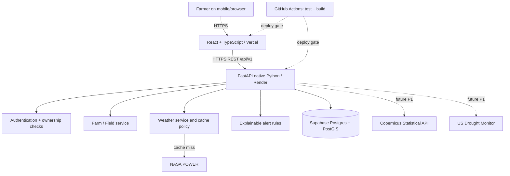
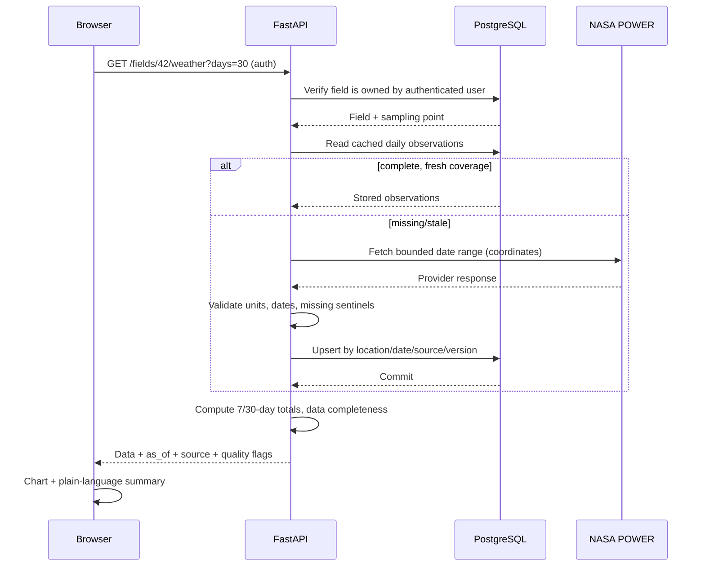

# AgriSense — System Design

**Version:** 1.0 (2026-11-24)  
**Status:** proposed target architecture; **not** a deployment or implementation claim  
**Users:** small and resource-constrained US farmers; mobile-first, low-data, no dedicated hardware  
**Constraints:** no Docker or personally managed containers; ship a pilot MVP in 14 days

## 1. Goals and non-goals

**P0**: registration/login; owner-only farm and field CRUD; map polygon or coordinate fallback; actual NASA POWER observations; 7-/30-day precipitation and temperature history; evidence-based low-rainfall signals with timestamps and uncertainty; responsive UI; automated test/build pipeline; deployed frontend, API and managed database.

**P1**: U.S. Drought Monitor regional context, cached Sentinel-2 NDVI with cloud masking and coverage warnings, notifications. **Not P0**: real-time soil probes, disease diagnosis, irrigation prescriptions, machine learning, payment processing, offline sync, microservices.

User trust is essential: every derived statement must identify source, date and basis, distinguish measured/modelled/regional data, and never fabricate observations. Small/irregular fields can have inadequate usable Sentinel-2 pixels.

## 2. Architecture



**Trust boundary:** Browser is untrusted. Never expose the PostgreSQL connection string or Copernicus client secret in `VITE_*` variables. FastAPI authenticates each protected request and authorizes resource ownership. Query only owned records, never trust a client-supplied `owner_id`.

**Why a modular monolith?** One API process and relational database are simpler to implement, deploy, debug and observe. Services stay separated in code. Scale with better queries, caches and horizontal app replicas before considering microservices.

## 3. Proposed backend structure

```text
backend/
  app/
    main.py                # application setup, CORS, exception handlers
    core/config.py         # validated settings from environment
    core/security.py       # password hashing, tokens, auth dependencies
    db/session.py          # engine, scoped session dependency
    db/models.py           # ORM entities
    api/v1/auth.py         # input/output boundary and status codes
    api/v1/farms.py
    api/v1/fields.py
    api/v1/weather.py
    api/v1/alerts.py
    schemas/               # Pydantic contracts
    services/farms.py      # use cases + permission checks
    services/weather.py    # caching, validation, normalization
    services/alerts.py     # transparent decision rules
    integrations/nasa.py   # HTTPX + timeouts/retries
    integrations/usdm.py   # P1
    integrations/copernicus.py # P1
  alembic/
  alembic.ini
  requirements.txt
  requirements-dev.txt
  tests/
```

**Route layer** validates HTTP request, obtains current user and DB session, calls a service and maps domain errors to HTTP. **Service layer** coordinates domain rules and transactions. **Repository/data access** uses SQLAlchemy; do not introduce generic repository abstractions just to add indirection. **Provider adapters** isolate upstream API formats. **Pydantic schemas** are external contracts, not database models.

Python sync SQLAlchemy sessions should be used by sync route functions or isolated from async event-loop blocking; choose consistent session behavior. HTTPX async clients should have bounded timeouts and connection reuse. Do not keep a DB transaction open while awaiting a slow external API: check cache, release session/transaction, fetch, then write in a new short transaction. Connection pooling must respect Supabase limits.

## 4. Main request lifecycle



**Caching policy:** Record observation date, retrieved time, source version and a normalized location key. Historical days can have long TTL; near-current days shorter. Missing/failed sources must never be replaced with fake zeroes. Use a unique key and upsert for concurrent requests. Cache keys should include provider, coordinates/spatial resolution, variables, date and processing version. For upstream outage, serve stale data **only with an explicit stale badge and as-of timestamp**; otherwise return a retriable 503/502.

## 5. Mobile accessibility and low operating cost

- One-field-at-a-time default; don't fetch all NDVI image tiles on dashboard load.
- Point-based onboarding fallback if polygon drawing fails on mobile; guided keyboard/accessible controls.
- Paginated field lists; compressed/cached static assets; charts render only requested date ranges.
- Plain-language alerts before complex charts. Display time zone, source, units, missing data and last update.
- Accessible contrast, touch targets, keyboard flow, tested at narrow viewports and simulated slow connections.
- One managed API and DB; provider requests cached and bounded; instrument outbound request count and cost.

## 6. Safety, reliability, failure modes

| Failure | Response |
|---|---|
| NASA timeouts / 429 / 5xx | Bounded retry with backoff and jitter for safe GETs, then stale-labelled data or 503 |
| Partial daily series | Keep null observations, report completeness and suppress claims requiring full coverage |
| Wrong user ID / farm ID | Query scoped to current user; return 404 to avoid leaking farm existence |
| Duplicate create submission | Accept idempotency key for mutation with deduplication, or disable button and handle replay safely |
| DB unavailable | No writes claimed; 503; alert server logs; health vs readiness checks distinct |
| Missing NDVI due to clouds | Report unavailable / low-quality observation, not unhealthy crop |
| Migration failure | Stop release; rollback application if schema still compatible; forward-fix DB if needed |
| Key leakage | Rotate secret, revoke old credential, investigate logs; never put private keys in Vite env |

**Security:** HTTPS; password hashing with vetted library (Argon2id preferred); short-lived signed credentials or managed auth; no credentials in local storage if using cookie design (use HttpOnly, Secure, SameSite with CSRF protection); input size caps; query parameter bounds; CORS explicit domains; least-privileged DB credentials; rate-limit login and expensive upstream queries. For pilot, choose one authentication method and test it end-to-end.

**Observability:** Structured request logs (request ID, route, status, duration), no personal data/tokens; metrics for API 5xx, provider timeouts, cache hit rate, external usage and DB latency; alert on unhealthy deployment. Encrypted provider-managed backups and a restoration drill before accepting real farmers' data.

## 7. Scale scenarios (planning assumptions, not measured benchmarks)

| Stage | Users | Proposed strategy |
|---|---:|---|
| Pilot | 100 | One API service, managed Postgres, indexes, DB cache, manual/periodic checks |
| Growth | 10,000 | Track request patterns; tune pool sizes, paginate, push expensive NDVI into idempotent background jobs, add per-user quotas |
| Large scale | 100,000 | Partition/time-series retention if justified, distributed cache/job workers as needed, autoscaling API, strict quotas and budget alarms |

Capacity depends on **active** users, fields per farmer, request frequency and time-series span—not registered-user count alone. Estimate peak RPS and provider cost from actual pilot analytics; load test before changing architecture.

## 8. Alternatives and engineering tradeoffs

| Decision | Choice now | Why | Revisit when |
|---|---|---|---|
| FastAPI vs Django | FastAPI | Existing API code and strong typed API contracts | Need an extensive built-in admin/ORM workflow |
| Postgres vs MongoDB | PostgreSQL + PostGIS | Ownership relations, transactions and spatial operators | Unlikely to change for this product |
| Leaflet vs MapLibre | Keep existing Leaflet | Smallest migration and adequate polygon editing | Vector tile styling / large maps become important |
| Native vs Docker | Native Python/npm + managed DB | User preference, reduced infrastructure overhead | Not needed unless reproducibility creates serious blockers |
| Synchronous request vs jobs | Synchronous cached weather; jobs for NDVI later | Weather typically small; satellite expensive | Processing repeatedly exceeds request budget |
| DB cache vs Redis | Database | One fewer service and sufficient at pilot scale | Cache pressure, lock contention or hot-key volume grows |
| Vercel FastAPI vs Render | Separate FastAPI on Render | Better control of long-running work and Python runtime | Serverless API becomes simpler and economical |
| Monolith vs microservices | Modular monolith | Fewer deploys and operational boundaries | Independent teams / independent scaling need |
| Raster storage vs NDVI stats | Computed aggregates + provider metadata | Cost, storage and bandwidth savings | Need detailed on-platform raster manipulation |

## 9. Teaching review questions

1. Why must the server verify farm ownership even if the browser hides other users' farms?
2. Why should a weather cache key include location **and** observation date?
3. What is different between an API health check and a database readiness check?
4. What changes if fetching NDVI takes 90 seconds instead of 2 seconds?
5. What exact evidence would justify adding Redis or splitting out a worker service?

## 10. Implementation inventory (important)

**Previously observed, not verified in the user's live repo:** User supplied an actual successful NASA POWER JSON response. A prior generated `agrisense-mvp.zip` includes FastAPI auth/farm/field/weather routes, weather cache, NDVI adapter, React/Leaflet frontend, SQLite fallback, and Docker configuration. The generated ZIP is only a *snapshot*, not proof those features exist in the user's current local checkout or are deployed. Database schema in that snapshot stores validated field GeoJSON rather than native PostGIS spatial types. It lacks a complete no-Docker Supabase deployment and GitHub Actions pipeline. **Do not mark features complete without repository inspection and tests.**

## Official references
- [Supabase PostGIS](https://supabase.com/docs/guides/database/extensions/postgis)
- [Supabase connection pooling](https://supabase.com/docs/guides/database/connecting-to-postgres/pooling-and-limits)
- [Render FastAPI](https://render.com/docs/deploy-fastapi)
- [Vercel Vite](https://vercel.com/docs/frameworks/frontend/vite)
- [Copernicus Statistical API](https://documentation.dataspace.copernicus.eu/APIs/SentinelHub/Statistical.html)
